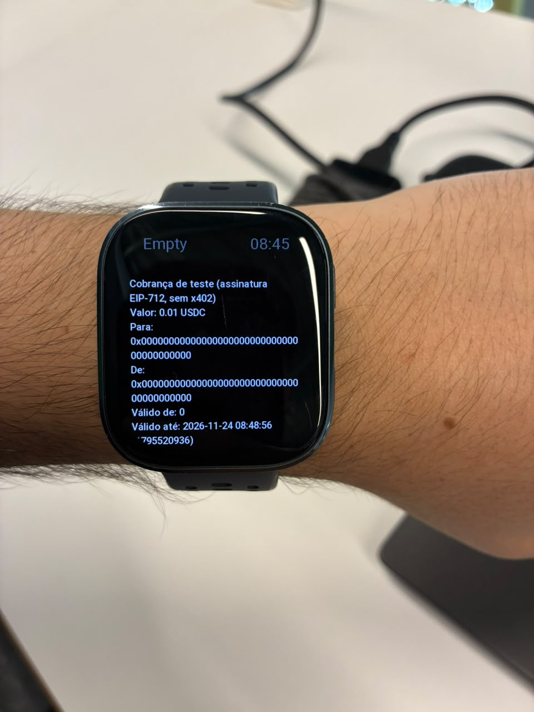
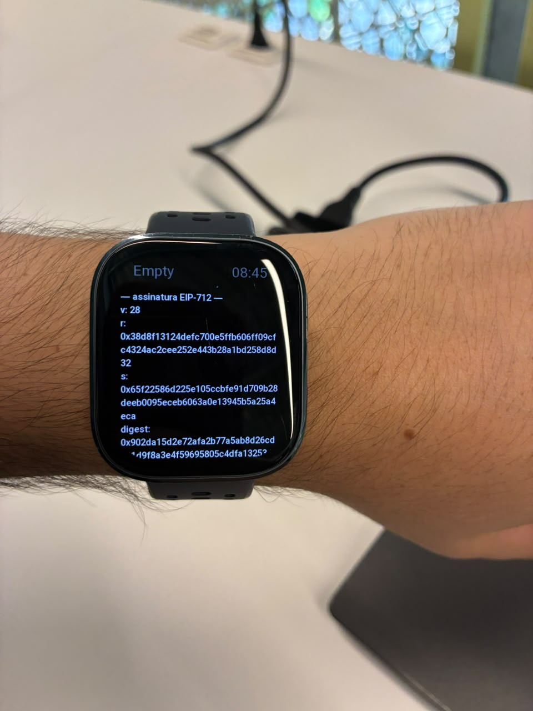
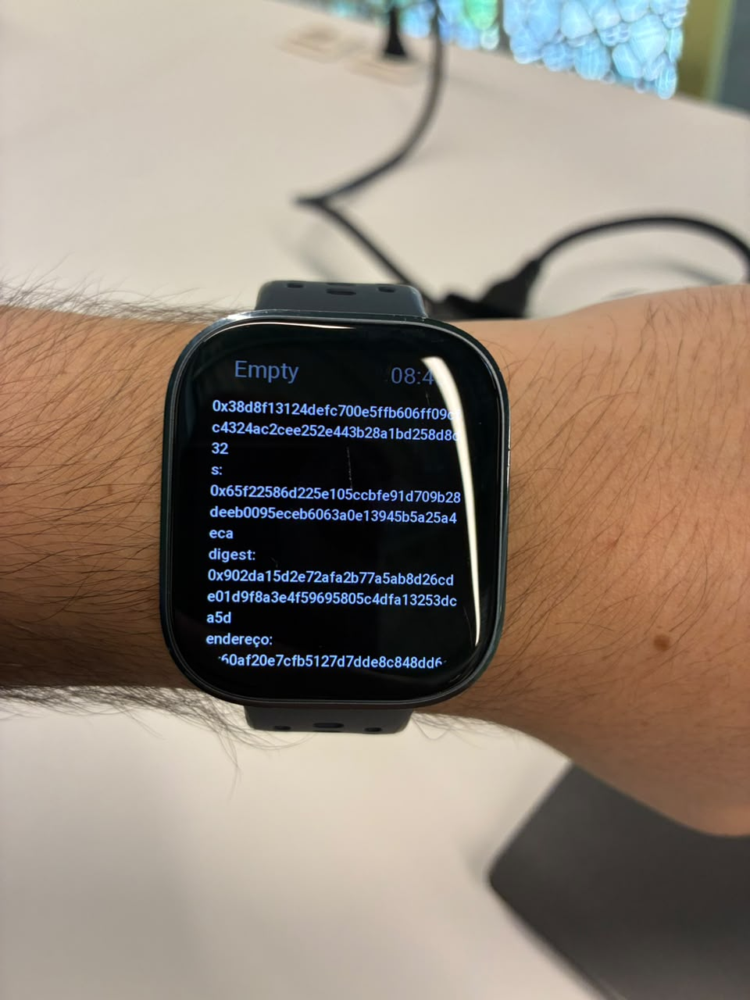
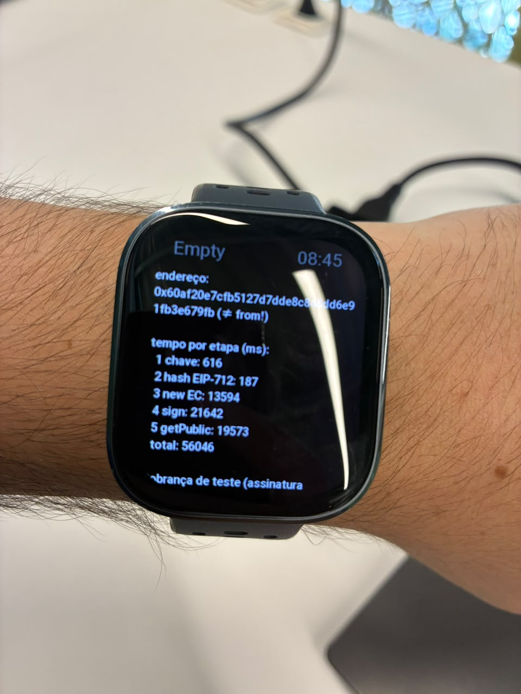
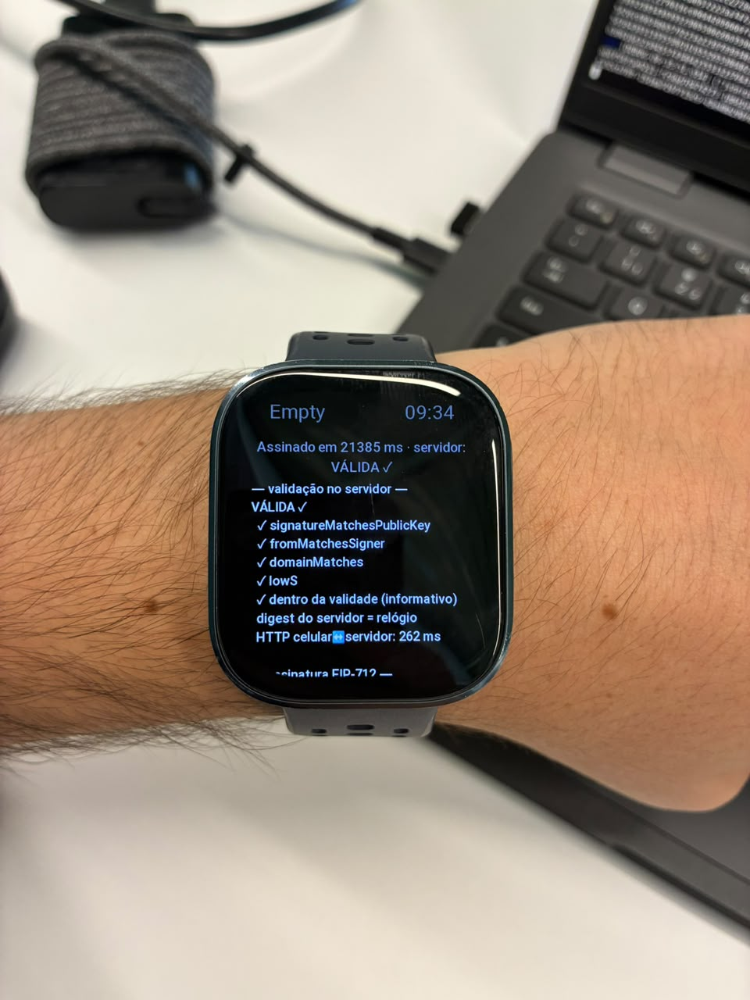
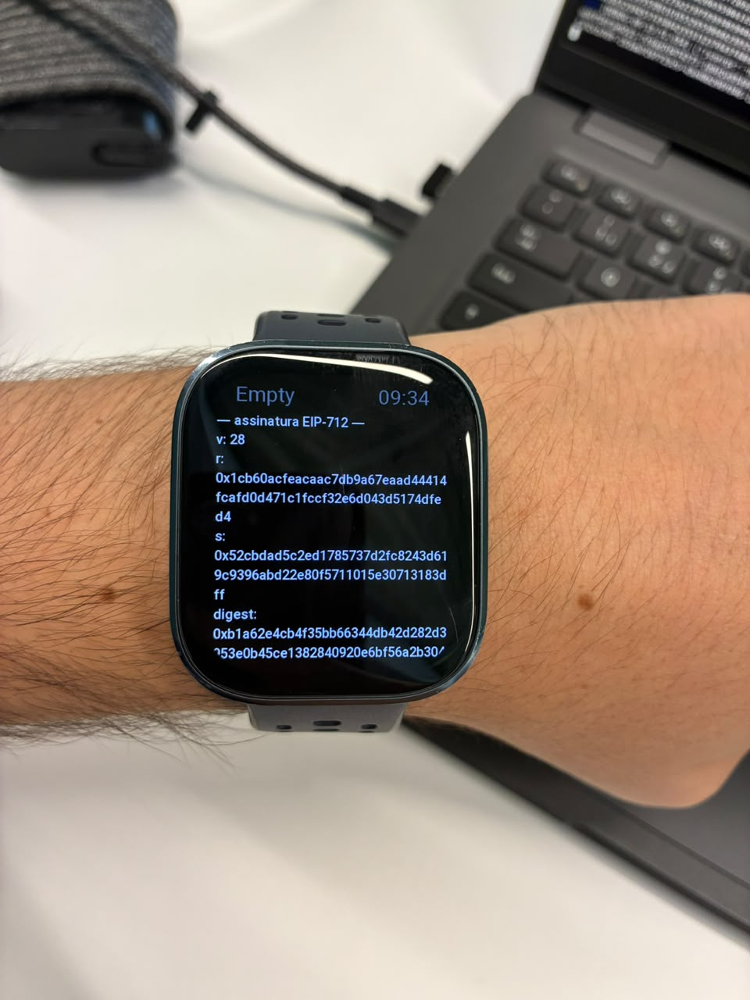
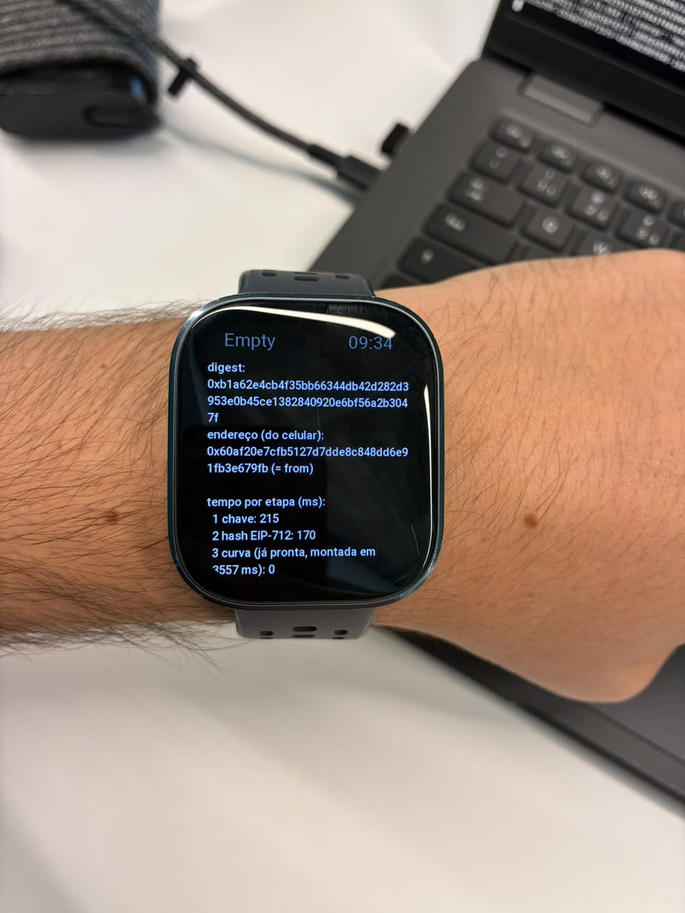
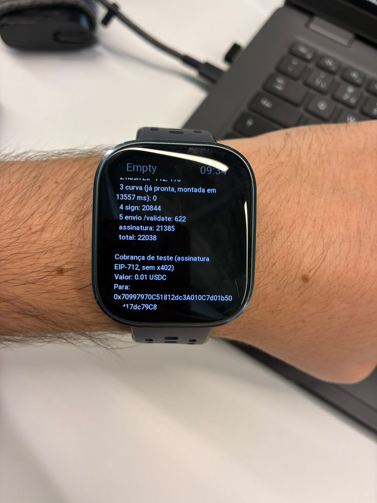
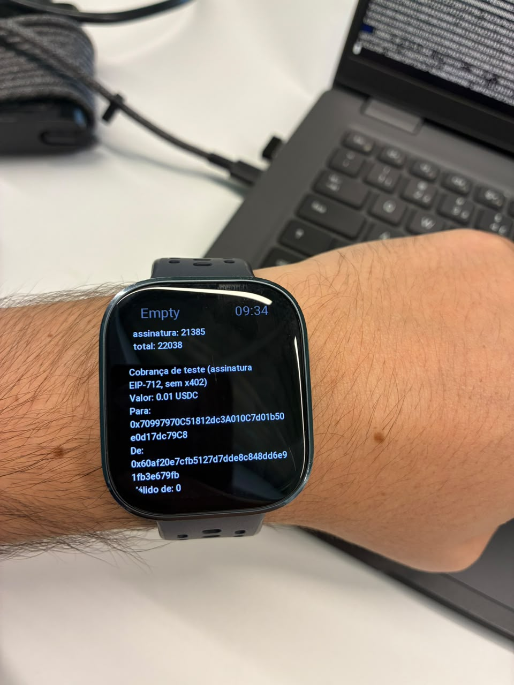

# x402 no Zepp OS: assinatura de pagamentos em um smartwatch

Pesquisa e implementação de um **assinante de pagamentos [x402](https://www.x402.org/)** rodando em um
**Amazfit Bip 6 (Zepp OS)**: o relógio guarda a chave, mostra o pagamento, coleta a aprovação do
usuário e assina a autorização EIP-3009/EIP-712 com ECDSA secp256k1, em JavaScript puro e sem `BigInt`.
O celular (app Zepp) apenas transporta as mensagens até o servidor de cobrança.

## Estrutura

| Pasta | Conteúdo |
|---|---|
| [`article/`](article/) | O artigo, versionado |
| [`invoice-server/`](invoice-server/) | Servidor HTTP de cobrança com middleware x402 |
| [`zepp-app/`](zepp-app/) | Mini app Zepp OS: Device App (relógio) + Side Service e Settings App (celular) |
| [`docs/`](docs/) | Documentação de apoio (inclui as [referências](docs/referencias.md)) |

## Arquitetura

```
┌───────────────────────┐   BLE    ┌──────────────────────┐  HTTPS   ┌──────────────────────┐
│ Relógio (Bip 6)       │ ───────▶ │ Celular (app Zepp)   │ ───────▶ │ Servidor de cobrança │
│ chave, política,      │ ◀─────── │ Side Service:        │ ◀─────── │ HTTP 402 + middleware│
│ aprovação, assinatura │          │ só transporta        │          │ x402, verificação    │
└───────────────────────┘          └──────────────────────┘          └──────────────────────┘
```

## Estado

- **Fase 1 (concluída, nov. 2026):** sondagem do runtime e criptografia simétrica em JS puro no
  relógio, validada de ponta a ponta. Resultados e limitações do hardware em
  [`docs/fase-1-resultados-e-limitacoes.md`](docs/fase-1-resultados-e-limitacoes.md).
- **Fase 2 (em andamento, nov. 2026):** secp256k1 + RFC 6979 + Keccak-256 + EIP-712 em JS puro no
  relógio. Fluxo completo validado no aparelho: o relógio assina a autorização EIP-712 com
  `elliptic`/`js-sha3`/`bn.js` (~21 s) e o servidor a valida com `viem` (VÁLIDA ✓, 22 s do toque ao
  veredito). Resultados parciais e decisões em
  [`docs/fase-2-assinatura-eip712.md`](docs/fase-2-assinatura-eip712.md).
- **Fase 3:** pagamento x402 ponta a ponta na Base Sepolia.

## Registros dos testes no aparelho (Fase 2)

Fotos da tela do Amazfit Bip 6 nos testes de 2026-11-24. Os valores mostrados (assinatura `r`, `s`,
`v`, digest e tempos) são os mesmos registrados em
[`docs/fase-2-assinatura-eip712.md`](docs/fase-2-assinatura-eip712.md). Carteira e chave são de
teste, sem fundos.

### Amostra 1 (08:45): primeira assinatura EIP-712 no relógio

Primeira assinatura calculada no aparelho, ainda sem envio ao servidor. A cobrança tinha `from` e `to`
zerados (o relógio aponta "≠ from!") e a curva foi montada na hora de assinar, junto com a derivação
do endereço no relógio. A assinatura foi conferida depois com o `viem`, que recuperou o endereço da
carteira de teste.

| Etapa | Tempo (ms) |
|---|---|
| 1. Chave (BLE) | 616 |
| 2. Hash EIP-712 | 187 |
| 3. Montar a curva (`new EC`) | 13.594 |
| 4. Assinar (`sign`) | 21.642 |
| 5. Derivar o endereço (`getPublic`) | 19.573 |
| **Total** | **56.046** |

| Cobrança | Assinatura | Digest e endereço | Tempos |
|---|---|---|---|
|  |  |  |  |

### E22 (09:34): fluxo completo validado pelo servidor

O relógio buscou a cobrança com `from` = carteira do relógio e `to` = endereço de teste, montou a curva
uma vez logo depois (13.557 ms), assinou e enviou a assinatura ao `POST /validate`. O servidor
conferiu com o `viem` e devolveu **VÁLIDA ✓**, com as quatro verificações aprovadas e o digest do
servidor igual ao do relógio.

| Etapa | Tempo (ms) |
|---|---|
| 1. Chave (BLE) | 215 |
| 2. Hash EIP-712 | 170 |
| 3. Curva (já montada após buscar a cobrança) | 0 |
| 4. Assinar (`sign`) | 20.844 |
| 5. Envio ao `/validate` (BLE + HTTPS 262 ms) | 622 |
| **Total (toque → veredito)** | **22.038** |

| Validação no servidor | Assinatura | Digest e tempos | Tempos | Cobrança |
|---|---|---|---|---|
|  |  |  |  |  |
